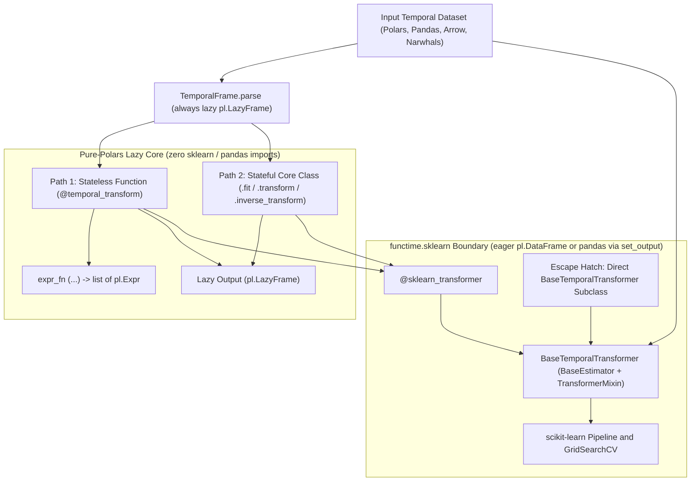

# Custom Transformers (`v2.0` Design & Contributor Guide)

!!! note "Target `v2.0` Design & Contributor Guide"
    This document specifies the target **`v2.0` transformer authoring architecture**—introduced incrementally across `v1.x` inside `functime._frame`, `functime._core`, and `functime.sklearn`, then promoted to shallow top-level `functime.*` domain modules in `v2.0`. It is intended both as a **contributor guide** and as a **reviewable design document** for refining the API prior to `v2.0`.

## Architecture Overview

`functime` separates every temporal transformation into two clean layers so pure-Polars data-frame users and `scikit-learn` pipeline users share one implementation without coupling or overhead:

1. **Pure-Polars lazy core** (`functime._frame` and `functime._core` during `v1.x`; top-level `functime.*` domain modules such as `functime.preprocessing` and `functime.feature_extraction` in `v2.0`): holds 100% of domain logic, accepts any Narwhals-supported container (eager or lazy), operates through `TemporalFrame`, and always returns `pl.LazyFrame` with **zero `scikit-learn` or Pandas imports**.
2. **Thin eager `functime.sklearn` wrappers** (`functime.sklearn.*`): mirror `scikit-learn` namespaces 1:1 on top of `BaseTemporalTransformer` (`BaseEstimator` + `TransformerMixin`), enforce `scikit-learn` validation and tags, collect to `pl.DataFrame` once at `transform` / `fit_transform` exit, and isolate `set_output(transform="pandas")` + Pandas index restoration inside `functime.sklearn`.



---

## The `TemporalFrame` Contract & Ordering

Every core transform parses its input once through `TemporalFrame.parse(...)`:

```python
frame = TemporalFrame.parse(
    data,
    time_col=time_col,
    entity_col=entity_col,
    columns=columns,
    allow_null_time=False,
    allow_null_entity=False,
    assume_sorted=False,
)
```

`TemporalFrame.parse(...)` converts any Narwhals-supported container (`pl.DataFrame`, `pl.LazyFrame`, `pd.DataFrame`, `pa.Table`, or Narwhals `DataFrame`/`LazyFrame`) into a single always-lazy `TemporalFrame` backed by `pl.LazyFrame`, validates `time_col` and `entity_col` (`str | Sequence[str] | None`), resolves `entity_cols: tuple[str, ...]` and `target_cols: tuple[str, ...]`, and records a `SortState`:

| `SortState` | Meaning | How detected |
| --- | --- | --- |
| `SortState.UNKNOWN` (`0`) | Ordering not yet established | Default for lazy frames or unsorted eager frames |
| `SortState.CHRONOLOGICAL` (`1`) | Ascending `time_col` within each entity (or series) | `time_col` `SORTED_ASC`, intra-entity check, or `assume_sorted=True` |
| `SortState.ENTITY_TIME_SORTED` (`2`) | Globally sorted by `[*entity_cols, time_col]` | O(1) Polars `SORTED_ASC` flags / single-entity block check |

### Chronological windowing without eager sort + restore

Legacy panel helpers frequently performed `.with_row_index()`, eagerly sorted the full frame, applied a shift or rolling expression, and sorted back to restore input order—breaking lazy query fusion and materializing intermediate buffers.

`TemporalFrame.over(expr, chronological=...)` avoids eager sorting by emitting Polars-native ordered window expressions:

- **Panel (`entity_cols` non-empty, `chronological=True`, `sort_state < CHRONOLOGICAL`)**: `expr.over(self.entity_cols, order_by=self.time_col)`
- **Univariate (`entity_cols` empty, `chronological=True`, `sort_state < CHRONOLOGICAL`)**: `expr.over(pl.lit(0), order_by=self.time_col)`
- **Elementwise (`chronological=False`) or already sorted (`sort_state >= CHRONOLOGICAL`)**: `expr.over(self.entity_cols)` for panels or plain `expr` for univariate series

Because `.over(..., order_by=time_col)` stays inside Polars' expression engine:

1. **Zero eager sorts** are executed, and original input row order is preserved naturally.
2. **Predicate and projection pushdown** remain intact across chained lazy transforms.
3. Algorithms that genuinely require materialized grouping order (for example, sequential stateful reductions) can explicitly call `frame.sort_entity_time()` or `frame.group_agg(exprs, chronological=True)`.

### Why core returns `pl.LazyFrame` while `functime.sklearn` collects

- **Core primitives always return `pl.LazyFrame`**: callers can chain `lf.pipe(step_a, ...).pipe(step_b, ...)` and let Polars optimize the entire logical plan before a single `.collect()`.
- **`functime.sklearn` collects to `pl.DataFrame` at `transform` / `fit_transform` exit**: multi-step `scikit-learn` `Pipeline` execution validates feature shapes/names and feeds intermediate outputs step-by-step. Collecting once at `BaseTemporalTransformer` exit avoids repeated eager/lazy/pandas conversion round-trips inside pipelines.
- **Pandas output isolation**: `set_output(transform="pandas")` and original Pandas `Index` / `MultiIndex` capture and restoration live **exclusively** in `functime.sklearn`—core modules never import `pandas`.

---

## Path 1 — Stateless Transforms (`@temporal_transform` + `@sklearn_transformer`)

Roughly **85%** of temporal transforms (elementwise math, lags, differences, rolling statistics, calendar/Fourier features) are **Stateless Transforms**: they require no **Fitted State** and can be written as pure Polars expression functions.

Decorate the pure Polars expression factory with `@temporal_transform(chronological=...)`, then bind a minimal 4-line `BaseTemporalTransformer` subclass with `@sklearn_transformer(fn)`:

### Example 1: Elementwise (`chronological=False`)

```python
from __future__ import annotations

from collections.abc import Sequence

import polars as pl

from functime._frame import temporal_transform
from functime.sklearn import BaseTemporalTransformer, sklearn_transformer


@temporal_transform(chronological=False)
def log_transform(
    columns: Sequence[str],
    *,
    offset: float = 0.0,
    base: float | None = None,
) -> list[pl.Expr]:
    """Compute natural or base-k logarithms on target columns."""
    out: list[pl.Expr] = []
    for col in columns:
        shifted = pl.col(col) + offset
        expr = shifted.log() if base is None else shifted.log(base=base)
        out.append(expr.alias(col))
    return out


@sklearn_transformer(log_transform)
class LogTransformer(BaseTemporalTransformer):
    """Apply a logarithmic transformation to temporal target columns.

    Parameters
    ----------
    time_col : str, default="time"
        Name of the temporal axis column.
    entity_col : str or sequence of str or None, default=None
        Column(s) partitioning independent panel entities.
    columns : sequence of str or None, default=None
        Subset of target columns to transform. Defaults to all non-axis columns.
    offset : float, default=0.0
        Constant added before taking the logarithm.
    base : float or None, default=None
        Logarithm base. Defaults to natural logarithm when ``None``.
    """

    offset: float = 0.0
    base: float | None = None
```

### Example 2: Chronological (`chronological=True`)

```python
@temporal_transform(chronological=True)
def log_return(
    columns: Sequence[str],
    *,
    lag: int = 1,
    base: float | None = None,
) -> list[pl.Expr]:
    """Compute chronological log returns over a fixed lag."""
    out: list[pl.Expr] = []
    for col in columns:
        ratio = pl.col(col) / pl.col(col).shift(lag)
        expr = ratio.log() if base is None else ratio.log(base=base)
        out.append(expr.alias(f"{col}__log_return_{lag}"))
    return out


@sklearn_transformer(log_return)
class LogReturnTransformer(BaseTemporalTransformer):
    """Compute chronological log returns per entity or series.

    Parameters
    ----------
    time_col : str, default="time"
        Name of the temporal axis column.
    entity_col : str or sequence of str or None, default=None
        Column(s) partitioning independent panel entities.
    columns : sequence of str or None, default=None
        Subset of target columns to transform. Defaults to all non-axis columns.
    lag : int, default=1
        Number of chronological steps between observations.
    base : float | None, default=None
        Logarithm base. Defaults to natural logarithm when ``None``.
    """

    lag: int = 1
    base: float | None = None
```

Notice that `time_col`, `entity_col`, and `columns` are already declared on `BaseTemporalTransformer`. Subclasses declare **only** transform-specific typed attributes with defaults and a NumPy docstring—zero `__init__`, `fit`, `transform`, or `get_params` boilerplate.

### Three usage modes unlocked automatically

From that single definition, users get three idiomatic workflows:

```python
from sklearn.pipeline import make_pipeline

# 1. Raw Polars expression helper (.expr_fn)
exprs = log_return.expr_fn(["sales"], lag=7)
lf.with_columns([expr.over("store_id", order_by="date") for expr in exprs])

# 2. Lazy DataFrame / LazyFrame piping (.pipe) — works on Polars, Pandas, Narwhals;
#    containers without .pipe (e.g. pyarrow.Table) call it directly: log_return(table, ...)
lf_out = df.pipe(log_return, time_col="date", entity_col="store_id", lag=7)
df_out = lf_out.collect()

# 3. scikit-learn Pipeline (eager pl.DataFrame output, or Pandas via set_output)
pipe = make_pipeline(
    LogReturnTransformer(time_col="date", entity_col="store_id", lag=7),
)
result = pipe.fit_transform(df)
```

---

## Path 2 — Stateful Transforms (Pure-Polars Core Class + `@sklearn_transformer`)

**Stateful Transforms** estimate **Fitted State** during calibration (such as per-entity means, standard deviations, quantiles, or Box-Cox lambdas) and apply—and optionally invert—that state on new observations.

### Why a plain pure-Polars class instead of loose functions

Splitting a stateful transform into three loose functions (`fit_scale`, `transform_scale`, `inverse_scale`) forces pure-Polars callers to manually pass opaque state tables around and keep column metadata synchronized. Conversely, wrapping a class in a redundant `fit_scale(...)` factory function creates two ways to do the same thing.

Instead, stateful core transforms are **plain pure-Polars classes** with zero `scikit-learn` imports:

- `.fit(data, *, time_col="time", entity_col=None, columns=None) -> Self` computes fitted statistics via `TemporalFrame.group_agg(...)`.
- `.transform(data) -> pl.LazyFrame` joins state via `TemporalFrame.join_state(..., handle_unknown=...)` and returns `pl.LazyFrame`.
- `.inverse_transform(data) -> pl.LazyFrame` (when invertible) joins the same state to restore original **Target** values lazily.

The **exact same `@sklearn_transformer(CoreClass)` decorator** wraps that core class into a `BaseTemporalTransformer` subclass, forwarding `fit`, `transform`, `fit_transform`, `inverse_transform`, `feature_names_out_`, `set_output`, and safe HTML representation automatically.

### Example: `Scaler` + `StandardScaler`

```python
from __future__ import annotations

from collections.abc import Sequence
from typing import Any, Self

import polars as pl

from functime._frame import HandleUnknown, TemporalFrame
from functime.sklearn import BaseTemporalTransformer, sklearn_transformer


class Scaler:
    """Standardize target columns per entity or globally in pure Polars.

    Parameters
    ----------
    with_mean : bool, default=True
        Center target columns by subtracting the fitted mean.
    with_std : bool, default=True
        Scale target columns by dividing by the fitted standard deviation.
    handle_unknown : {"global", "identity", "null", "error"}, default="global"
        Policy applied when transforming an unseen entity.
    """

    def __init__(
        self,
        *,
        with_mean: bool = True,
        with_std: bool = True,
        handle_unknown: HandleUnknown = "global",
    ) -> None:
        self.with_mean = with_mean
        self.with_std = with_std
        self.handle_unknown = handle_unknown

    def fit(
        self,
        data: TemporalFrame | Any,
        *,
        time_col: str = "time",
        entity_col: str | Sequence[str] | None = None,
        columns: Sequence[str] | None = None,
    ) -> Self:
        """Estimate scaling statistics from historical observations."""
        frame = TemporalFrame.parse(
            data, time_col=time_col, entity_col=entity_col, columns=columns
        )
        self._time_col = frame.time_col
        self._entity_col = frame.entity_cols or None
        self._target_cols = frame.target_cols

        agg_exprs = [
            expr
            for col in frame.target_cols
            for expr in (
                pl.col(col).mean().alias(f"__mean_{col}"),
                pl.col(col).std(ddof=0).alias(f"__std_{col}"),
            )
        ]
        self._state_df = frame.group_agg(agg_exprs).collect()
        self._global_df = frame.lf.select(agg_exprs).collect()
        return self

    def transform(self, data: TemporalFrame | Any) -> pl.LazyFrame:
        """Apply fitted scaling statistics lazily."""
        frame = self._parse_transform_frame(data)
        joined = frame.join_state(self._state_df, handle_unknown=self.handle_unknown)
        exprs = [self._scale_expr(col) for col in self._target_cols]
        drop_cols = [
            name
            for col in self._target_cols
            for name in (f"__mean_{col}", f"__std_{col}")
        ]
        return joined.lf.with_columns(exprs).drop(drop_cols)

    def inverse_transform(self, data: TemporalFrame | Any) -> pl.LazyFrame:
        """Restore original target scale lazily."""
        frame = self._parse_transform_frame(data)
        joined = frame.join_state(self._state_df, handle_unknown=self.handle_unknown)
        exprs = [self._unscale_expr(col) for col in self._target_cols]
        drop_cols = [
            name
            for col in self._target_cols
            for name in (f"__mean_{col}", f"__std_{col}")
        ]
        return joined.lf.with_columns(exprs).drop(drop_cols)

    def _parse_transform_frame(self, data: TemporalFrame | Any) -> TemporalFrame:
        return TemporalFrame.parse(
            data,
            time_col=self._time_col,
            entity_col=self._entity_col,
            columns=self._target_cols,
        )

    def _stat_expr(self, prefix: str, col: str, default: float) -> pl.Expr:
        stat = pl.col(f"{prefix}_{col}")
        if self.handle_unknown == "global":
            fallback = float(self._global_df.get_column(f"{prefix}_{col}").item(0))
            return stat.fill_null(fallback)
        if self.handle_unknown == "identity":
            return stat.fill_null(default)
        return stat

    def _scale_expr(self, col: str) -> pl.Expr:
        expr = pl.col(col)
        if self.with_mean:
            expr = expr - self._stat_expr("__mean", col, 0.0)
        if self.with_std:
            std = self._stat_expr("__std", col, 1.0)
            safe_std = pl.when(std == 0.0).then(1.0).otherwise(std)
            expr = expr / safe_std
        return expr.alias(col)

    def _unscale_expr(self, col: str) -> pl.Expr:
        expr = pl.col(col)
        if self.with_std:
            std = self._stat_expr("__std", col, 1.0)
            safe_std = pl.when(std == 0.0).then(1.0).otherwise(std)
            expr = expr * safe_std
        if self.with_mean:
            expr = expr + self._stat_expr("__mean", col, 0.0)
        return expr.alias(col)


@sklearn_transformer(Scaler)
class StandardScaler(BaseTemporalTransformer):
    """Standardize temporal target columns per entity or series.

    Parameters
    ----------
    time_col : str, default="time"
        Name of the temporal axis column.
    entity_col : str or sequence of str or None, default=None
        Column(s) partitioning independent panel entities.
    columns : sequence of str or None, default=None
        Subset of target columns to transform. Defaults to all non-axis columns.
    with_mean : bool, default=True
        Center target columns by subtracting the fitted mean.
    with_std : bool, default=True
        Scale target columns by dividing by the fitted standard deviation.
    handle_unknown : {"global", "identity", "null", "error"}, default="global"
        Policy applied when transforming an unseen entity.
    """

    with_mean: bool = True
    with_std: bool = True
    handle_unknown: HandleUnknown = "global"
```

---

## Escape Hatch — Direct `BaseTemporalTransformer` Subclassing

When an estimator needs custom `scikit-learn` lifecycle hooks—for example, using target `y` during `fit`, computing bespoke `feature_names_out_`, implementing a single-pass `_fit_transform_frame` optimization, or overriding `_temporal_regime` / `_allow_null_time`—subclass `BaseTemporalTransformer` directly:

```python
from __future__ import annotations

from collections.abc import Sequence
from typing import Any, ClassVar

import polars as pl

from functime._frame import TemporalFrame
from functime.sklearn._base import BaseTemporalTransformer, TemporalRegime


class SeasonalDiffTransformer(BaseTemporalTransformer):
    """Difference target columns against observations ``sp`` steps earlier.

    Parameters
    ----------
    time_col : str, default="time"
        Name of the temporal axis column.
    entity_col : str or sequence of str or None, default=None
        Column(s) partitioning independent panel entities.
    columns : sequence of str or None, default=None
        Subset of target columns to transform. Defaults to all non-axis columns.
    sp : int, default=1
        Seasonal period lag in steps along the temporal axis.
    """

    _temporal_regime: ClassVar[TemporalRegime] = "row_stateless"
    _allow_null_time: ClassVar[bool] = False

    def __init__(
        self,
        time_col: str = "time",
        entity_col: str | Sequence[str] | None = None,
        columns: Sequence[str] | None = None,
        sp: int = 1,
    ) -> None:
        super().__init__(time_col=time_col, entity_col=entity_col, columns=columns)
        self.sp = sp

    def _fit_frame(self, frame: TemporalFrame, y: Any = None) -> None:
        self.feature_names_out_ = tuple(frame.columns)

    def _transform_frame(self, frame: TemporalFrame) -> TemporalFrame:
        return frame.with_exprs(
            [pl.col(col).diff(n=self.sp).alias(col) for col in frame.target_cols],
            chronological=True,
        )
```

---

## Why Explicit Inheritance from `BaseTemporalTransformer` Is Required

It is tempting to ask whether `@sklearn_transformer` could eliminate `class Foo(BaseTemporalTransformer):` and inject `BaseTemporalTransformer` automatically at decoration time. **Explicit inheritance is intentionally required** for three concrete engineering reasons:

1. **Python runtime, `pickle`, and `sklearn.base.clone()`:**
   - Mutating `cls.__bases__ = (BaseTemporalTransformer,)` at runtime raises `TypeError` in CPython whenever the target base has a different C-level slot layout or `tp_dealloc` than `object`.
   - Returning a newly synthesized wrapper class (`type(cls.__name__, (cls, BaseTemporalTransformer), ...)`) breaks `pickle` (module attribute lookup fails or diverges), breaks `sklearn.base.clone()` class identity checks, and breaks zero-argument `super()` inside methods because the closure `__class__` cell points to the original unwrapped class.
   - With explicit inheritance, `@sklearn_transformer` mutates/augments the exact class object in place and returns it unchanged in identity.

2. **Static typing (`pyrefly`) and IDE support:**
   - PEP 681 (`@dataclass_transform`) lets static type checkers infer generated `__init__` parameter signatures from annotated class attributes, **but it cannot synthesize inherited methods** such as `.fit()`, `.transform()`, `.fit_transform()`, `.inverse_transform()`, `.set_output()`, or `.get_feature_names_out()`.
   - Writing `class LogTransformer(BaseTemporalTransformer):` gives `pyrefly` and editor language servers complete visibility into the `BaseTemporalTransformer` contract—providing full static verification, go-to-definition, hover docstrings, and autocomplete with zero `# type: ignore` workarounds.

3. **Immediate `scikit-learn` clarity:**
   - Seeing `class LogTransformer(BaseTemporalTransformer):` communicates on line 1—to both users and PR reviewers—that the class is a full `BaseEstimator` + `TransformerMixin` estimator obeying `scikit-learn` conventions.

---

## Contributor & Verification Checklist

Before opening or updating a transformer PR, verify every item below (see `AGENTS.md` and `GLOSSARY.md` for full repo rules):

- [ ] **Top-down ("stepdown") module ordering**: main public classes and entry points first (public methods before private hooks inside classes), reusable public functions next, private `_helpers` at the bottom.
- [ ] **Public-only NumPy docstrings**: concise NumPy-style docstrings on public classes/functions; **no** docstrings on private `_helpers` or private hooks (`_fit_frame`, `_transform_frame`, etc.).
- [ ] **Strict layer isolation**: zero `scikit-learn` or `pandas` imports inside `functime._frame` / `functime._core` (and future `v2.0` top-level domain modules).
- [ ] **Ubiquitous `Temporal` language**: use canonical terms from `GLOSSARY.md` (`Temporal`, `Entity`, `Time Axis`, `Target`, etc.) instead of legacy `panel`-only names.
- [ ] **Contract test coverage**: run `assert_temporal_transformer_contracts(...)` covering univariate series, multi-column entities, shuffled row preservation, Narwhals/Polars/Pandas/PyArrow containers, `set_output` + index restoration, `clone()`, pickling, `get_feature_names_out()`, and invalid input rejection.
- [ ] **`scikit-learn` estimator checks**: include the new transformer in `parametrize_with_checks(...)` with explicit `expected_failed_checks` only for 2D-NumPy-only checks.
- [ ] **Lint & strict typing**: pass `uvx ruff check .` and strict `uv run pyrefly check` with zero `basic` sub-config exemptions.

---

## Open Design Questions for Review

Reviewers and contributors are invited to weigh in on four open design questions before finalizing the `v2.0` surface:

1. **`columns` selection conventions on `@sklearn_transformer`**: How should `columns` support string names, sequences, or Polars column selectors (`polars.selectors`) while keeping `get_params()` / `clone()` / HTML repr clean and ensuring consistent `feature_names_in_` vs `columns_` checks across `fit` and `transform`?
2. **Stateful `.inverse_transform` behavior on unseen entities**: Should `.inverse_transform` share the exact `handle_unknown` policy used in `.transform` (`"global"`, `"identity"`, `"null"`, `"error"`), or enforce stricter error semantics when reconstructing original **Target** values for entities absent from **Fitted State**?
3. **Polars namespace or `.with_columns` integration for `@temporal_transform`**: Beyond `.expr_fn(...)` and `df.pipe(...)`, should `@temporal_transform` functions expose an optional column-naming / replacement option (`suffix` vs in-place overwrite) or integrate with a Polars expression/DataFrame namespace?
4. **`entity_reducing` regime ergonomics**: What shared contract should `entity_reducing` transforms (reducing each **Entity** time series into summary rows, such as feature extractors) expose on `BaseTemporalTransformer` and `@sklearn_transformer` regarding `time_col` omission, `feature_names_out_`, and `get_feature_names_out()`?
